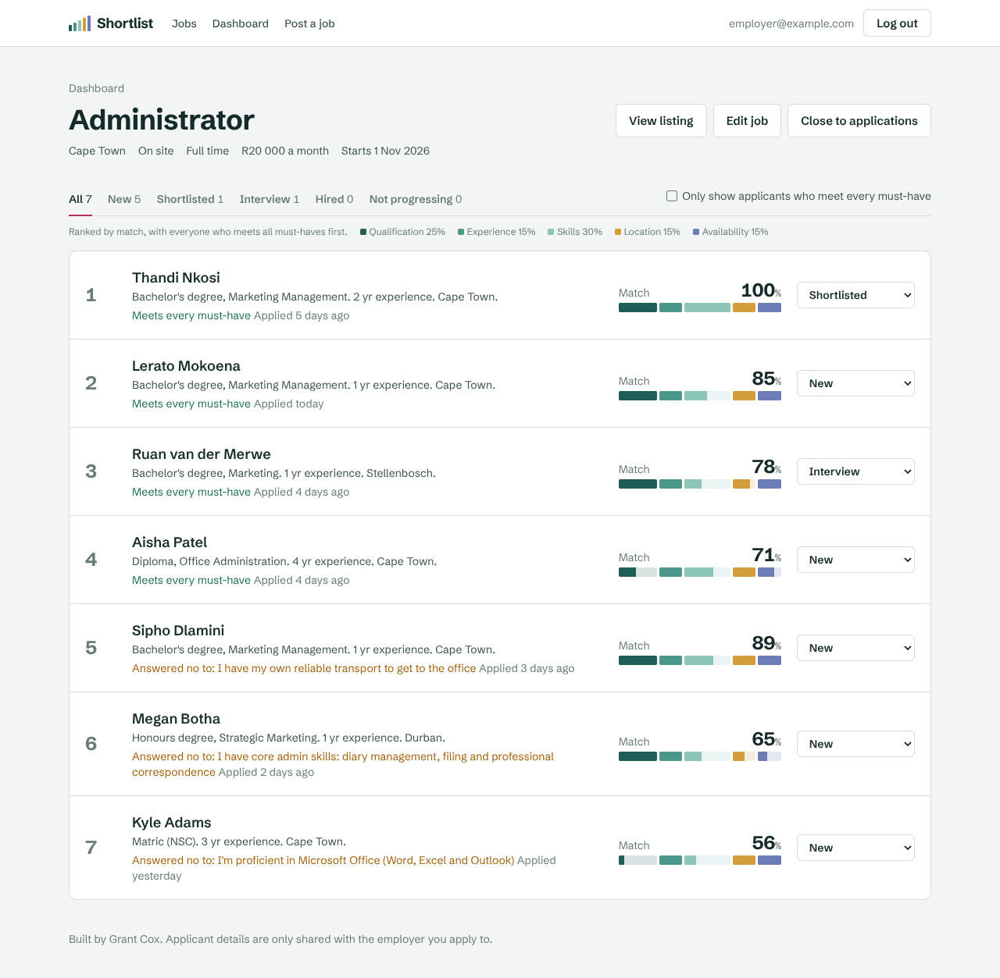
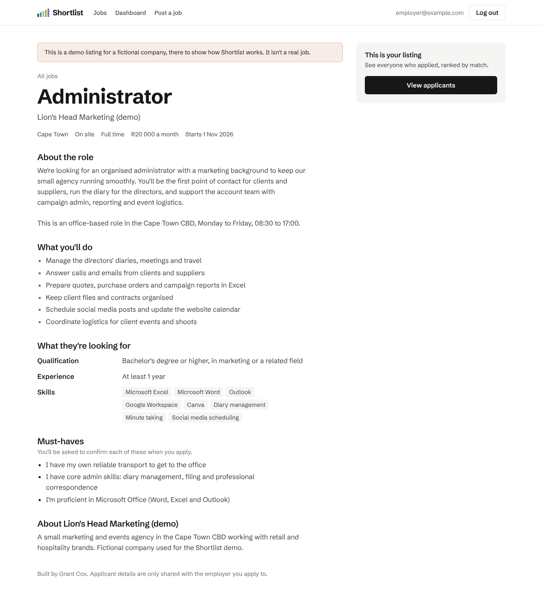
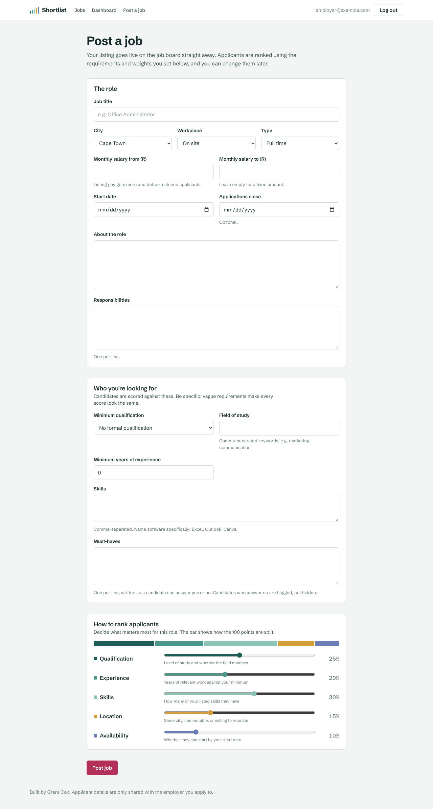
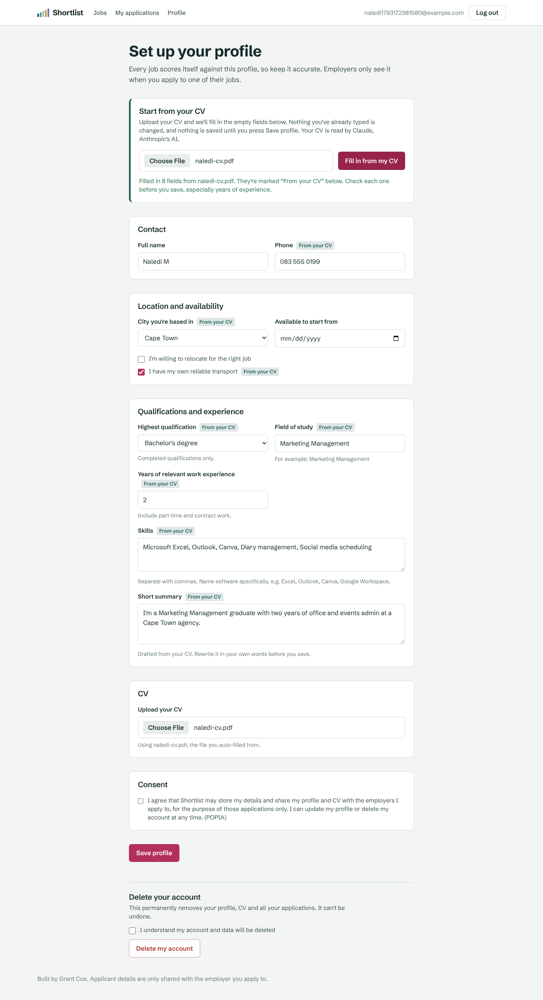

# Shortlist

A two-sided job board that scores every candidate against every job, and shows both sides exactly where the score comes from.

- **Candidates** build one profile (qualification, experience, skills, location, availability, CV), browse open jobs and see their match score on each before applying.
- **Employers** post a role, list must-haves, and decide how much each criterion counts. Applicants arrive ranked, with the reasons beside every score. The employer makes every decision; nobody is auto-rejected.
- **Finding candidates:** open jobs can be listed on Google for Jobs, and every job link shows a preview card when shared on LinkedIn or WhatsApp.
- **Fast sign-up:** candidates can upload their CV and have Claude fill in their profile for them to check.
- **Job seeker tools:** saved jobs, search filters, similar jobs, company pages, job alerts by email, and a talent pool employers can invite people from.
- **Hiring tools:** a drag-and-drop applicant board, private star ratings, listing stats, CSV export, and a daily email of new applicants.
- **Safety:** scam warnings on every job, and a report button. Jobs reported by three people are hidden until an admin reviews them.



## How matching works

Each job is scored on five criteria. The employer splits 100% between them, with a 1%-step slider or by typing a number; changing one shares the difference between the others, so the total always stays at 100%:

| Criterion | How it's scored |
| --- | --- |
| Qualification | 60% for meeting the minimum level (partial credit below it), 40% for a field of study matching the job's keywords |
| Experience | Years of relevant experience against the minimum, capped at full marks |
| Skills | Share of the job's listed skills the candidate has. Skills are matched by meaning, not wording (see below) |
| Location | Straight-line distance: within 25 km 100%, within 60 km (commutable) 75%, further away 50% if willing to relocate, otherwise 0%. Remote roles always 100%. Places without coordinates fall back to comparing names |
| Availability | Can start by the start date 100%, within 2 weeks 70%, within a month 40%, later 10% |

**Must-haves** are yes/no questions the candidate answers when applying. A "no" is flagged and sorts the applicant below everyone who meets all must-haves, but they stay visible.

The score is drawn as one bar split into five coloured lanes. Each lane's width is the employer's weight; how much of it is filled is how well the candidate meets that criterion, so the gaps show exactly where points were lost.

**Skills** are picked as tags. As you type, the picker suggests standard names from a list of about 80 common skills ([`src/lib/skills.ts`](src/lib/skills.ts)), and anything typed is mapped to its standard name, so "MS Excel", "excel" and "spreadsheets" all become Microsoft Excel, and "calendar management" becomes Diary management. Suites count for their programs: a candidate with "MS Office" has Excel, Word, Outlook, PowerPoint and Teams. Skills that aren't on the list still work: they're kept as typed and matched loosely. CV auto-fill uses the same names.

The engine is a pure function in [`src/lib/matching.ts`](src/lib/matching.ts) with unit tests in [`src/lib/matching.test.ts`](src/lib/matching.test.ts).

| Job page with match breakdown | Posting a job and setting weights |
| --- | --- |
|  |  |

## Google for Jobs

Each open job page carries [JobPosting structured data](https://developers.google.com/search/docs/appearance/structured-data/job-posting), and open jobs are listed in `/sitemap.xml`, so Google can show them in its job search panel. The markup is built in [`src/lib/job-posting.ts`](src/lib/job-posting.ts).

- **Off by default.** It's switched on with `LIST_JOBS_ON_GOOGLE=true`, because Google doesn't allow fake or test postings, and anyone can sign up and post a job on a public demo.
- **Demo companies are never listed**, and their job pages are labelled as demos and marked `noindex`.
- **Closed jobs drop out.** A job leaves the sitemap and is marked `noindex` once it's closed or its closing date passes (in South African time). Visitors following an old link see a "This job has closed" page with similar open jobs, rather than an error. Closing dates set `validThrough`.
- Fully remote jobs are marked `TELECOMMUTE` with applicants limited to South Africa, and the description says so, as Google requires. Hybrid jobs aren't marked remote.

Employers see whether each job is listed, and get a copy-link button and LinkedIn, WhatsApp and email share links. Shared links show a preview image with the job title, company, location and salary:


## CV auto-fill

On the profile page, a candidate can upload their CV and press **Fill in from my CV**. The PDF is sent to Claude (`claude-haiku-5-5` by default) using [structured outputs](https://platform.claude.com/docs/en/build-with-claude/structured-outputs), so the reply always matches a fixed schema: name, phone, city, highest completed qualification, field of study, years of experience, skills, a draft summary, and whether they mention their own transport.

- **Only empty fields are filled.** Nothing the candidate typed is overwritten; skills are added to, not replaced. Each filled field is tagged "From your CV" until they edit it.
- **Nothing is saved automatically.** The candidate checks the form and saves it themselves. The same file is set as their CV, so they don't choose it twice.
- **The CV is treated as data**, never as instructions, and the reply is cleaned up before use (unknown cities and qualification wordings are dropped or matched, years are capped, skills de-duplicated).
- **Limited to 10 reads per person per day**, so the API bill can't run away.
- **Hidden unless `ANTHROPIC_API_KEY` is set.** Get a key from the [Claude Console](https://console.anthropic.com). Reading a one or two page CV with Haiku costs a fraction of a cent; see [Anthropic's pricing](https://www.anthropic.com/pricing) for current rates.



The schema and clean-up live in [`src/lib/cv-extraction.ts`](src/lib/cv-extraction.ts), the API call in [`src/lib/cv-autofill.ts`](src/lib/cv-autofill.ts), and the merge rules in [`src/lib/autofill-merge.ts`](src/lib/autofill-merge.ts).

## Locations

Location fields (employer sign-up, company details, candidate profile, job form) suggest South African suburbs and towns as you type, using [Photon](https://photon.komoot.io), komoot's free geocoder for [OpenStreetMap](https://www.openstreetmap.org/copyright) data. No API key or billing is needed.

- Picking a suggestion stores its coordinates, which the match score uses for real distances. "Claremont, Cape Town" and "Claremont, Durban" are told apart.
- People can also type a place that isn't suggested. If it names a main city it still gets coordinates; otherwise location is scored by comparing names.
- Searches go through the app's own `/api/places` route, so visitors' typing isn't sent straight to a third party, and answers are cached for a day.
- The public Photon server is free under fair use. If the site grows, run your own Photon instance or switch providers by changing `PLACES_API_URL`.

## Forgot password

**Forgot your password?** on the log-in page emails a reset link.

- Links work once, for 60 minutes, and only a hash of each is stored.
- The form always says the same thing, so it can't be used to find out who has an account, and sends at most three emails an hour per account.
- Resetting signs the account out on every other device.
- Emails go through any SMTP server. Without one, `npm run dev` prints the link in the terminal, and the live site says password reset isn't available.

### Sending email with Gmail (free, no domain needed)

1. Turn on [2-Step Verification](https://myaccount.google.com/security) for the Google account.
2. Create an [app password](https://myaccount.google.com/apppasswords) and copy the 16-character code.
3. Add these environment variables (in `.env.local`, and in Vercel):
   ```
   SMTP_HOST=smtp.gmail.com
   SMTP_PORT=465
   SMTP_USER=your.address@gmail.com
   SMTP_PASS=the app password, without spaces
   ```

Gmail allows about 500 emails a day and sends from your own address. Once the site has its own domain, a provider such as [Resend](https://resend.com) or Brevo is better: use its SMTP settings and set `EMAIL_FROM`, for example `Shortlist <no-reply@yourdomain.co.za>`.

## Job seeker and hiring tools

These were picked by looking at what LinkedIn, Indeed, PNet, Welcome to the Jungle (Otta), Workable and Greenhouse offer, and keeping what fits a small South African job board.

**For candidates**

| Feature | What it does |
| --- | --- |
| Saved jobs | A Save button on every job. Saved jobs are listed on the dashboard with their match and closing date. Applying removes a job from the list. |
| Filters and sorting | Workplace, job type, minimum salary and date posted, sorted by best match, newest, highest salary or closing soonest. Jobs closing within a week say so. |
| Similar jobs | Each job page suggests up to three open jobs sharing skills, title words or field ([`src/lib/similar.ts`](src/lib/similar.ts)). |
| Company pages | `/companies/<id>` shows the company's details and every job it has open. |
| Company logos | Employers upload a logo under Company details. The browser shrinks it to 256px (WebP) before upload; the server only accepts real PNG, JPEG or WebP files. It shows on job lists, job pages, the company page and in Google job data. Companies without one get a tile with their initials. Served from `/logos/<id>`. |
| Benefits | Employers tick benefits (medical aid, provident fund, 13th cheque…). They show on the job and in the Google markup. |
| Job alerts | A daily or weekly email of new jobs scoring at least the match the candidate chooses. Nothing is sent when there's nothing new. |
| Application receipts | An email as soon as someone applies, saying what happens next |
| Application updates | One email a day listing any status changes (shortlisted, interview, hired, not progressing). A status changed by mistake and changed back that day is never emailed. |
| Talent pool | Candidates can tick "open to opportunities". Employers then see an anonymous version of their profile (qualification, experience, skills, city, availability, but no name, contact details or CV) scored against each job, and can invite them to apply. Invitations are emailed straight away, up to 25 a day per employer. |

**Messages**

Everyone has a username (made from their name at sign-up, changeable in Settings). People message each other by username at `/messages`, and a job can be sent inside a message from its Share button, where "Send in a message" is the first option, followed by email, copy link, WhatsApp, Facebook, LinkedIn, X and Telegram. Messages stay inside Shortlist (no emails); the menu shows an unread count and conversations refresh every few seconds while open. Email addresses are never shown in messages. Anyone can block someone from their conversation, and sending is capped (60 messages an hour, 30 new conversations a day).

**For employers**

| Feature | What it does |
| --- | --- |
| Pipeline board | Applicants in one column per stage. Drag a card, or use its menu, which also works by keyboard and on phones. |
| Ratings | A private 1 to 5 star rating on each applicant, shown in the list and on the board, with a sort by rating. |
| Listing stats | Views, applications, the share of viewers who applied, average match and how many meet every must-have. A view is counted once per browser tab; the employer's own visits and search engine crawlers don't count. |
| CSV export | Every applicant in ranked order with contact details, scores, must-have answers, status, rating and notes. Text that could run as a spreadsheet formula is neutralised. |
| New applicant email | One email a day per employer, with new applicants per job and the best match. |

**Trust and safety**

- Every job page says Shortlist never charges to apply and warns against sharing bank details or ID numbers, the usual signs of South African job scams.
- Signed-in users can report a job, once each. Each report emails the site admins. A job reported by three different people is hidden from the board, can't be applied for, and its employer is told it's under review.
- Admins (the accounts listed in `ADMIN_EMAILS`) review reports at `/admin`: restore the job, or remove it for good. Removed jobs can be restored later.

### Daily emails

The once-a-day emails (application updates, new applicants, job alerts) are sent by `/api/cron/daily`, which [Vercel Cron](https://vercel.com/docs/cron-jobs) calls every morning, as set in [`vercel.json`](vercel.json). On the free Hobby plan it runs some time between 08:00 and 09:00 South African time.

- It only runs when `CRON_SECRET` is set. Vercel sends that value with each call, so nobody else can trigger it.
- Each email is claimed in the database before it's sent, so a repeated or overlapping run never sends anything twice.
- It sends at most 300 emails a run, to stay inside Gmail's daily limit.
- Every email has a one-click unsubscribe link, and people can change everything at `/settings`.
- Demo accounts use `example.com` addresses, which can't receive mail, so nothing is sent to them.
- Locally, with no `CRON_SECRET`, visit `http://localhost:3000/api/cron/daily` in `npm run dev` to run it by hand. The emails are printed in the terminal if SMTP isn't set up.

## Importing jobs

To post several jobs at once, for example on behalf of an employer who has sent their ads, put them in a JSON file (see [`imports/old-school.json`](imports/old-school.json) for the format) and run:

```bash
npm run jobs:import -- imports/old-school.json --employer hiring@company.co.za --dry-run   # check only
npm run jobs:import -- imports/old-school.json --employer hiring@company.co.za
```

- The employer account must already exist. Jobs show under its company name, and its owner sees the applicants.
- Jobs are checked against the same rules as the Post a job form, and skills are mapped to their standard names.
- A job that account already has open with the same title is skipped, so running the same file again only posts what's new.
- For the live site, set `DATABASE_URL` first, as for `db:migrate`.

## Tech stack

- [Next.js](https://nextjs.org) (App Router, server components and server actions), TypeScript, Tailwind CSS
- [Drizzle ORM](https://orm.drizzle.team) on PostgreSQL
- [PGlite](https://pglite.dev) for local development: real Postgres running inside Node, so there is nothing to install
- Email and password login with bcrypt-hashed passwords and a signed, HTTP-only session cookie (`jose`)
- CVs stored in the database (PDF only, 2 MB cap), downloadable only by the candidate and employers they applied to
- [Claude API](https://platform.claude.com/docs) (`@anthropic-ai/sdk`) for CV auto-fill
- Nodemailer for email, Vercel Cron for the daily emails, Photon (OpenStreetMap) for place suggestions
- Vitest for the matching engine, distances, Google markup, CV auto-fill rules, similar jobs, CSV export, unsubscribe links and email wording

## Run it locally

You need [Node.js](https://nodejs.org) 20 or newer.

```bash
npm install
npm run setup     # creates the local database in .data/ and adds demo data
npm run dev       # http://localhost:3000
```

Demo logins (password `demo-password` for both):

- `employer@example.com`: Lion's Head Marketing, hiring the Administrator role
- `candidate@example.com`: a marketing graduate who hasn't applied for the Administrator role yet

To try CV auto-fill locally, create a file called `.env.local` in the project folder containing `ANTHROPIC_API_KEY=your-key`, then restart `npm run dev`. All the optional settings are listed in [`.env.example`](.env.example).

Other commands:

```bash
npm test                    # unit tests
npm run db:seed -- --reset  # wipe all data and reload the demo data
npm run db:reset            # delete the local database entirely and set it up again
```

## Deploy it (Vercel + hosted Postgres)

1. **Put the code on GitHub.** Create an empty repository, then:
   ```bash
   git remote add origin https://github.com/<your-username>/shortlist.git
   git push -u origin main
   ```
2. **Create a Postgres database** with [Neon](https://neon.tech) or [Supabase](https://supabase.com) and copy its connection string.
3. **Create the tables and demo data** from your computer, pointing at that database:
   ```bash
   DATABASE_URL="postgres://..." npm run setup
   ```
   (On Windows PowerShell: `$env:DATABASE_URL="postgres://..."; npm run setup`)
4. **Import the repository on [Vercel](https://vercel.com/new)** and add two environment variables:
   - `DATABASE_URL`: the connection string from step 2
   - `AUTH_SECRET`: a long random string. Generate one with
     `node -e "console.log(require('crypto').randomBytes(32).toString('base64url'))"`
5. Deploy. Every push to `main` redeploys.
6. **Optional: CV auto-fill.** Add `ANTHROPIC_API_KEY` in Vercel and redeploy.
7. **Optional: email.** Add the four `SMTP_` variables (see [Forgot password](#forgot-password)) for password resets and invitations. For the daily emails, also add `CRON_SECRET` (any long random string, generated the same way as `AUTH_SECRET`). Redeploy.
   To review reported jobs, add `ADMIN_EMAILS` with your own email address (comma-separated for more than one), sign up on the site with that address, and a **Reports** link appears in the menu.

   The privacy policy (`/privacy`) and terms (`/terms`) give `CONTACT_EMAIL` as the address to write to, or, if that isn't set, the first `ADMIN_EMAILS` address, then `SMTP_USER`.
8. **Optional: Google for Jobs**, once real employers are posting:
   1. Add `LIST_JOBS_ON_GOOGLE` = `true` in Vercel and redeploy.
   2. In [Google Search Console](https://search.google.com/search-console), add a **URL prefix** property for your site address and choose the **HTML tag** method. Copy the `content` value into a `GOOGLE_SITE_VERIFICATION` variable, redeploy, then press Verify.
   3. Under **Sitemaps**, submit `sitemap.xml`.
   4. Check a job page with Google's [Rich Results Test](https://search.google.com/test/rich-results). Google usually takes a few days to start showing jobs.

When you change `src/db/schema.ts`, run `npm run db:generate` to create a migration, then `npm run db:migrate` locally and against production. Whenever you pull changes that add a file to `drizzle/`, run `DATABASE_URL="postgres://..." npm run db:migrate` once against your hosted database before (or straight after) the new code deploys, otherwise the live site will error.

## Project layout

```
src/
  app/
    actions/          server actions: auth, candidate, employer, settings, reports, admin
    jobs/             job board, job page (with Google markup and share image), apply and report flows
    companies/        public company pages
    candidate/        candidate dashboard and profile (with CV auto-fill)
    employer/         employer dashboard, post/edit job, ranked applicants, board, talent pool, CSV export
    settings/         email and talent pool settings
    admin/            reported job review
    api/              place search, view counting, daily emails, one-click unsubscribe
    cv/[candidateId]/ access-controlled CV download
    sitemap.ts        open jobs and companies for search engines
    robots.ts         keeps dashboards and CVs out of search
  components/         fit bar, job list, pipeline board, ratings, form helpers
  db/                 schema and connection (PGlite locally, Postgres in production)
  lib/                matching engine, auth, queries, ranking, Google markup, CV auto-fill,
                      similar jobs, emails and the daily email job
assets/fonts/         Schibsted Grotesk (SIL Open Font License) for share images
scripts/              migrate and seed
drizzle/              SQL migrations
```

## Known limitations and next steps

- Must-have answers and profile details are self-reported. Interviews and reference checks still matter.
- Field-of-study matching is keyword based, so "Marketing Management" matches "marketing" but "Brand Strategy" wouldn't unless the employer adds that keyword.
- Daily emails depend on Vercel Cron, which the free plan runs once a day. Instant emails would need a paid plan or a queue.
- Reports need three different accounts to hide a job, and accounts are free, so a determined person could hide a real job until an admin restores it.
- Google listing has no moderation: once switched on, any employer's open job is offered to Google. A live product would want new employers approved first.
- CV auto-fill sends the CV to Anthropic's API. A live product should say so in its privacy policy.
- Email addresses aren't verified at sign-up.
- CVs live in the database, which is fine at demo scale. At larger scale they should move to object storage (Supabase Storage, Vercel Blob or S3).
- POPIA basics are covered (consent before sharing, CV access control, self-service account deletion), but a live product would also need a privacy policy and a data retention period for closed jobs.
